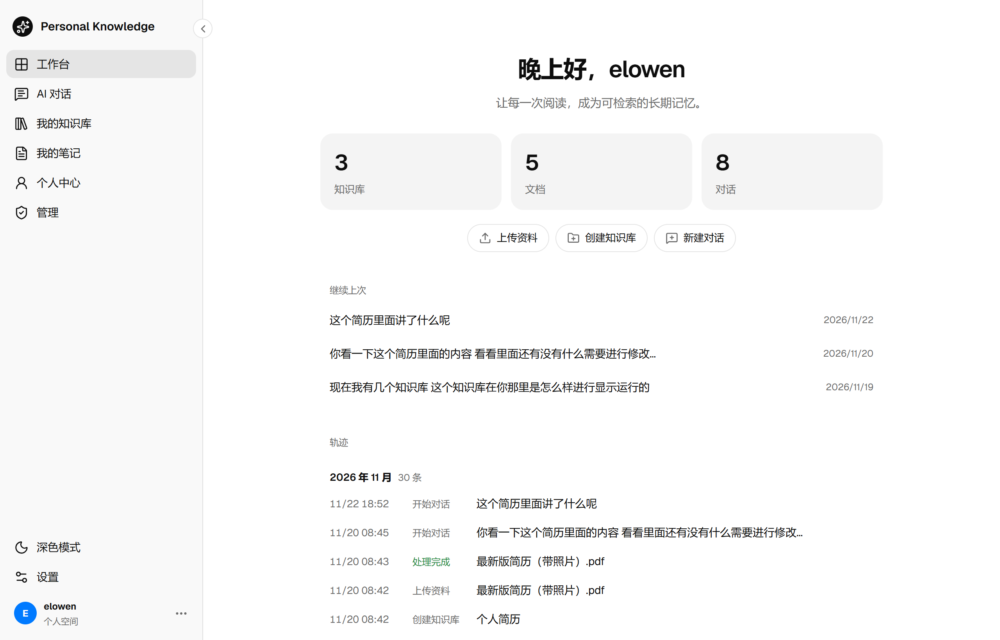
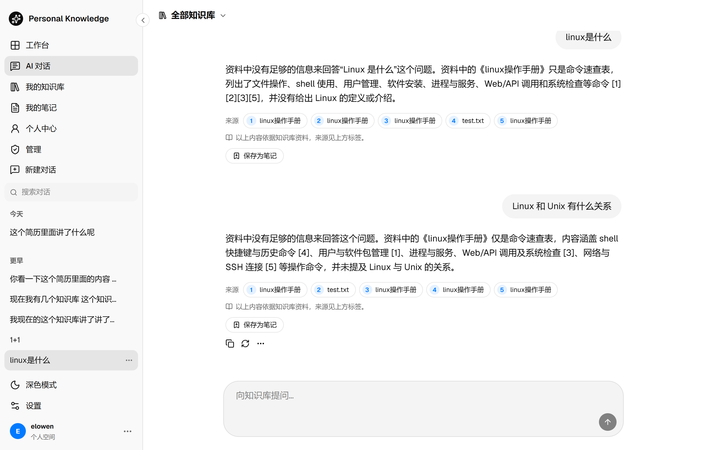
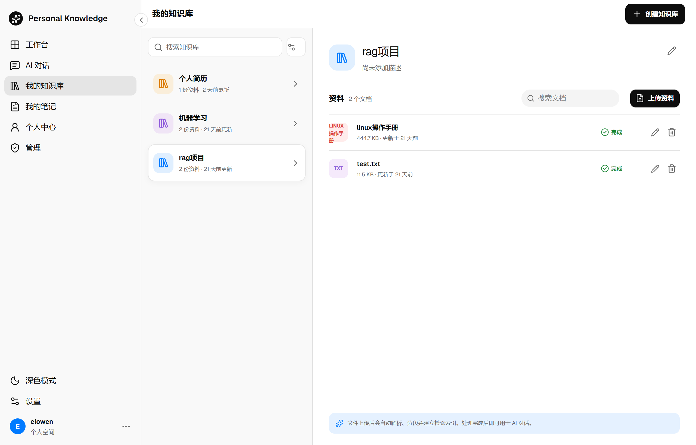
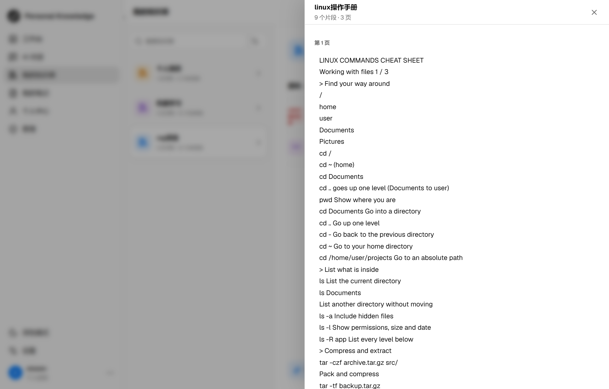
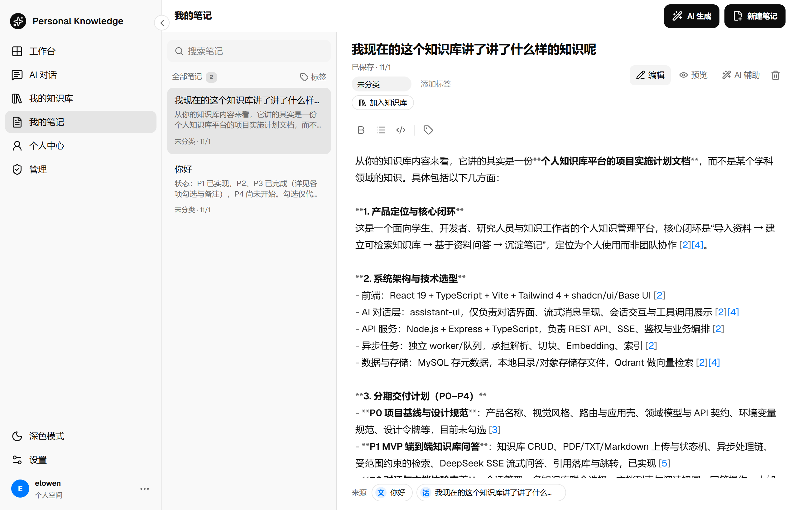

# Personal Knowledge

个人知识库平台：导入资料 → 建立可检索知识库 → 基于资料问答 → 沉淀笔记。

## 当前状态

- 前后端已全部接入真实数据：工作台、AI 对话、我的知识库、我的笔记、个人中心（账号、AI 设置、使用统计、数据导出与账号删除）。
- 多用户：用户名 + 密码登录，注册需要一次性邀请码；每个用户的数据相互隔离。
- 每用户有限流与每日 token 额度、文档数与存储量配额（默认值见 `server/.env.example`）。

## 在线演示

https://knowledge.myelowen.fun 可以用演示账号直接登录：

| 用户名 | 密码 |
| --- | --- |
| `demo` | `demo-readonly` |

演示账号的知识库里就是本仓库的 README、DESIGN、TODO 三份文档，可以直接问「这个项目的向量检索用的是什么」，回答会带上出处。

它是**只读**的：可以浏览知识库、提问、看引用；上传、删除、改名、改设置一律返回 403，每日模型额度也单独设了上限（默认 3 万 token），避免被拿去烧额度。

需要用自己账号时，第一个注册的账号自动成为管理员，之后通过邀请码注册：`cd server && npm run invite`。

## 界面

| 工作台 | AI 对话（严格模式：资料不足时明确拒答，不编造） |
| --- | --- |
|  |  |
| **我的知识库**（文档处理状态、上传、重命名、重试） | **阅读抽屉**（按分块展示原文，可定位到被引用的片段） |
|  |  |
| **我的笔记**（Markdown 编辑 + AI 辅助） | |
|  | |

## 技术栈

- 前端：React 19 + TypeScript + Vite + Tailwind CSS 4 + shadcn/ui（Base UI）+ assistant-ui + zustand + react-router
- 后端（`server/`）：Express 5 + MySQL + Qdrant；Embedding 走 OpenAI 兼容接口，对话模型为 DeepSeek

## 开发

```bash
pnpm install
pnpm dev      # 启动开发服务器
pnpm build    # 类型检查并构建
pnpm lint     # oxlint 检查
pnpm test     # 前端单元测试（vitest，只跑纯逻辑，不需要浏览器）
```

提交到 `main` 或发起 PR 后，GitHub Actions（`.github/workflows/ci.yml`）会自动执行前端 lint/test/build 与后端 typecheck/test。

## 后端

需要本地可用的 MySQL 与 Qdrant。

```bash
cd server
cp .env.example .env   # 填写数据库、模型服务密钥、Qdrant 地址
npm install
npm run migrate        # 执行 server/migrations 下的迁移（含建库）
npm run dev            # 启动后端（tsx watch）
npm run typecheck      # 后端类型检查
npm test               # 单元测试（Node 自带 test runner）
```

账号相关脚本（在 `server/` 下运行）：

```bash
npm run invite                              # 生成一个一次性邀请码；第一个注册的账号自动成为管理员
npm run reset-password -- <用户名> <新密码>   # 重置密码（8 到 128 位），并使该账号已有登录失效
npm run reindex                             # 按数据库中的分块重建 Qdrant 向量（迁移、恢复备份后使用，会消耗 Embedding 额度）
```

`.env` 含密钥，不要提交到版本库。前端开发服务器通过 `/api` 访问后端（`vite.config.ts` 中 `changeOrigin` 必须为 false，否则后端的同源校验会拒绝登录）。

### 检索调优

问答的检索结果有两个可调点：

- **多轮追问**：`"它有什么优点"`、`"第二点展开说说"` 这类脱离上文没有主语的问题，会先把上一轮的用户提问拼进检索查询（`server/src/modules/rag/query.ts`）。只影响检索，发给模型的仍是用户原话。
- **相似度下限** `RETRIEVAL_MIN_SCORE`：低于该分数的资料不会进入提示词，`0` 表示不过滤。

标定方法：问答日志（`journalctl -u personal-knowledge -o cat | grep '"event":"chat"'`）每条都有 `scores`（本次实际分数）、`hits`（进入提示词的条数）、`candidates`（检索命中数）、`filtered`（被下限丢弃的条数）。拿几个你已知「库里确实没有」和「库里确实有」的问题各问一次，把下限定在两组分数之间。也可以直接调检索接口对比：

```bash
curl -s localhost:3001/api/rag/search -H 'Content-Type: application/json' \
  -d '{"query":"你的问题","minScore":0}'   # minScore 传 0 可关掉过滤，看完整分数
```

#### 精排（rerank）

向量召回只保证「语义相近」，不保证「能回答这个问题」。开启精排后，会先召回一批候选（默认 `max(topK×4, 20)`，上限 50），再用 cross-encoder 逐条判断相关性，只把过线的交给模型。

启用方式（`server/.env`）：

```ini
RERANK_ENABLED=true
RERANK_MIN_SCORE=0.1
```

模型默认 `BAAI/bge-reranker-v2-m3`，复用 `EMBEDDING_BASE_URL` / `EMBEDDING_API_KEY`（同一个硅基流动账号），不需要额外密钥。

`RERANK_MIN_SCORE` 的标定方式与相似度下限相同，先用 `RERANK_SHADOW=true` 收集分布（照常调用并记录 `rerankScores`，但结果仍用向量排序），再定阈值。**注意 rerank 分数与向量相似度不是一个尺度**：当前实测 bge-reranker-v2-m3 通过硅基流动返回的是归一化到 0~1 的分数，相关约 0.26~0.99，无关约 0.001~0.007。

一次实测（4 份文档 / 34 分块 / 10 条评估题，`npm run eval`）：

| | 精排关 | 精排开 + 阈值 0.1 |
| --- | --- | --- |
| 有答案的题 recall@5 | 8/8 | 8/8 |
| 库里没有的题正确拒答 | **0/2** | **2/2** |
| 每题进入提示词的分块数 | 5 | 1~4 |
| 单次检索耗时 | ~290ms | ~900ms |

代价是首字延迟增加数百毫秒。文档多、检索预算大时收益更明显；如果只有几十个分块，`RETRIEVAL_MIN_SCORE` 调高往往就够，可以先不开精排。

#### 在更大的语料上重新标定（23 条评估集）

上面的结论来自 4 份文档的小语料。换成语料更完整的演示知识库（README / DESIGN / TODO，28 个分块）重跑后，结论变了：

| 配置 | recall@5 | recall@20 | MRR@5 | 正确拒答 | 单次耗时 |
| --- | --- | --- | --- | --- | --- |
| 基线（向量下限 0.35） | 83.3% | 100% | 0.625 | 0/5 | 245ms |
| **精排只重排，不设阈值** | **100%** | 100% | **0.768** | 0/5 | 650ms |
| 精排 + 阈值 0.1 | 61.1% | 61.1% | 0.583 | 4/5 | 709ms |
| 向量下限提到 0.5 | 72.2% | 77.8% | 0.579 | 4/5 | 206ms |

三个可直接抄走的结论：

1. **精排最大的价值是排序，不是过滤。** 基线里 recall@20 已经是 100%，但 top-5 只有 83.3%——有三条相关分块被排在 8、13、19 名。精排只重排、不设阈值，就能把这部分全部救回来（83.3% → 100%，MRR 0.625 → 0.768）。
2. **任何为了拒答而上调阈值的手段都在牺牲召回。** 精排阈值 0.1 能把无关问题的正确拒答从 0/5 提到 4/5，但 top-5 命中率掉到 61.1%；把向量下限提到 0.5 也是同样的取舍（拒答 4/5，命中 72.2%）。
3. **阈值分数在不同语料上不可复用。** 同一套代码，旧语料上 `RERANK_MIN_SCORE=0.1` 表现良好，换到新语料就把一半正样本滤掉了（实测负样本最高 0.135、正样本最低 0.132，分数区间重叠，单一阈值分不开）。

因此生产默认**只把精排当排序器用**（`RERANK_ENABLED=true`，不设 `RERANK_MIN_SCORE`）：它永远只改善顺序、不会丢资料。拒答交给提示词（资料无关时模型可以不引用）和严格模式；确实需要阈值时，必须用你自己的语料重新标定。

#### 混合检索（默认关闭）

向量检索擅长语义，但对「型号 / 人名 / 错误码 / 代码标识符」这类字面内容不敏感。开启后会在向量召回之外再跑一路 MySQL 全文检索（ngram 分词，中文按二元组切，不需要额外词典），用 RRF 融合两路名次：

```ini
RETRIEVAL_HYBRID=true
```

**实测结论：在这套评估集上没有收益。** 23 条问题里只有 2 条真正命中了关键词路——因为题目都是语义型问法，和正文没有共享的字面片段；各项指标与纯向量检索完全持平（recall@5 83.3%、MRR 0.625）。它的价值要体现在含精确标识符的查询上，所以默认关闭，需要时再开。关键词路失败会自动退回纯向量结果，不影响主流程。

评估工具：`cd server && npm run eval`，读取 `server/eval/dataset.json`，输出 recall@k / MRR / 拒答率，报告写到 `server/eval/reports/`（已在 `.gitignore` 中）。

### 长对话摘要

发给模型的历史只保留最近 10 条消息。更早的内容会被压缩成一段摘要（`conversations.summary`），随提示词一起传下去，所以长对话不会在第 6 轮之后「忘记」前面说过什么。

- **怎么触发**：每次回答结束后（不阻塞响应）检查一次——滑出窗口的消息、且还没被摘要覆盖的，累积到 6 条以上就重新合并摘要。摘要会写回对话，并记录覆盖到哪条消息（`summary_until_message_id`），下次只处理新增部分。
- **成本**：平均每 3 轮对话多一次模型调用，计入 `usage_logs` 的 `summary` 类型。
- **失败处理**：摘要生成失败只记日志，保留旧摘要，不影响问答。
- **重新生成/编辑消息**会让旧摘要作废（因为它可能引用了已被删除的内容），下次重新累积。
- 相关参数在 `server/src/config.ts` 的 `chat` 段：`maxHistoryMessages`、`summaryMinMessages`、`summaryMaxChars`、`summaryInputChars`。

### 流式阶段提示

`/api/chat` 的 SSE 除了消息事件，还会发 `stage`：

- `retrieving`：开始检索；
- `reranking`：即将调用精排（仅在开启精排且候选多于一条时）；
- `generating`：检索完成，带 `hits`（进入提示词的资料条数）。

前端在对话工具栏显示「正在检索资料… / 正在精排候选片段… / 已找到 N 个片段，正在生成回答…」，回答结束、报错或用户停止时自动清除。连接每 15 秒发一行 `: ping` 注释心跳，前端的 SSE 解析器会忽略注释。

### 行内引用

回答正文里的 `[1]`、`[2][3]`、`[4, 5]` 会渲染成可点击角标，点击直接打开阅读抽屉并定位到对应分块。生成过程中来源还没到达时显示中性角标；回答结束后仍对不上的编号标红，并在来源下方汇总「有 N 处引用无法对应资料」。问答日志新增 `invalidCitations`，用来观察模型编造编号的情况。

### 检索诊断

每条回答落库时会把 `retrieval_meta` 一起存下来（迁移 020）：

- 实际检索串、是否做过追问改写、无效引用数；
- 命中分块：分块 id、文档、页码、向量分、精排分、来自哪一路（dense / keyword / both）；
- 候选数、被下限过滤数、关键词命中数、精排是否降级；
- 检索 / 首字 / 总耗时；
- 当时生效的配置快照：`topK`、严格模式、回复风格、`minScore`、hybrid 与 rerank 开关、rerank 模型、embedding 与对话模型、`chunkerVersion`、`promptVersion`。

回答下方可以展开「检索诊断」查看 JSON，历史回答也有。改切片或提示词时同步改 `CHUNKER_VERSION`（`server/src/modules/worker/chunk.ts`）和 `PROMPT_VERSION`（`server/src/modules/chat/prompt.ts`），诊断里就能区分新旧回答。

### 回答反馈

每条回答下方有 👍 / 👎。点踩会先记一条负反馈，再弹出原因（答非所问 / 资料过时 / 找不到信息 / 引用错误 / 内容不完整 / 其他），可以补一句不超过 500 字的说明；同一条消息重复提交会覆盖上一次，不会产生多条记录。

- 数据表：`message_feedback`（迁移 019），一条消息每个用户只保留一条；
- 接口：`POST /api/messages/:id/feedback`，只能给自己的助手消息反馈，限流 30 次/分钟；
- 历史回答也能反馈：打开对话时消息会带上数据库 id，点踩时用它关联。

## 部署

推荐结构：nginx 托管前端构建产物并反代 `/api`；后端和 Qdrant 只监听 127.0.0.1；MySQL 不对外。`deploy/` 下有可直接修改使用的模板：

| 文件 | 用途 |
| --- | --- |
| `personal-knowledge.service` | 后端的 systemd 服务（`npm run start`） |
| `qdrant.service` | Qdrant 官方 Linux 二进制的 systemd 服务，只绑定 127.0.0.1 |
| `nginx-knowledge.conf` | 80 跳转 443，静态文件 + `/api` 反代（SSE 不缓冲、传 `Host`）、安全响应头 |
| `backup.sh` | 每日备份 MySQL 和上传文件，保留最近 14 份 |

要点：

- 反代必须原样传递 `Host`（后端按它做同源校验），并设置 `X-Forwarded-Proto`（后端已 `trust proxy` 回环地址，Cookie 才会带 `Secure`）。必须用 HTTPS。
- 前端是单页应用：`/chat`、`/notes` 这类页面地址由前端路由处理，静态服务器必须把未命中的路径回退到 `index.html`（模板里是 `try_files $uri /index.html`），否则刷新或直接访问这些地址会 404。
- 前端：本机 `pnpm build`，把 `dist/` 上传到服务器；后端：上传 `server/`（不含 `node_modules`、`.env`、`uploads`），`npm ci` 后 `systemctl restart personal-knowledge`；有新迁移时先 `npm run migrate`。
- 不要把 Qdrant（6333/6334）和 MySQL（3306）绑定到公网。若用 Docker 运行 Qdrant，端口映射写成 `127.0.0.1:6333:6333`。
- 内存紧张的小机器建议加 swap；两个 systemd 服务都设了 `MemoryMax`。
- 日志为 JSON 行：`journalctl -u personal-knowledge -o cat | grep '"event":"request"'`；问答另有 `"event":"chat"`（含检索命中、耗时、token，不含问题与回答内容）。

### 日常更新（一键部署）

服务器上的 `/opt/personal-knowledge` 是 git 仓库，本地用脚本完成「构建 → 上传 → 拉取 → 迁移 → 重启」：

```powershell
./scripts/deploy.ps1                  # 完整部署（前端 + 后端）
./scripts/deploy.ps1 -SkipFrontend    # 只更新后端（前端没改动时）
./scripts/deploy.ps1 -SkipBuild       # 复用上次 dist，不重新构建
```

脚本要求本机能 SSH 到服务器（默认用 `~/.ssh/id_ed25519_pk`，没有则回退到密码）。**注意：某些代理客户端会拦截 22 端口，需要给服务器 IP 加直连规则。**

服务端步骤在 `scripts/deploy-remote.sh`，单独执行也可以：

```bash
cd /opt/personal-knowledge && SKIP_FRONTEND=1 bash /tmp/deploy-remote.sh
```

脚本只在 `package-lock.json` 变化时才 `npm ci`；迁移用 `npm run migrate`（幂等，已应用的会跳过）。前端旧的构建产物会保留在 `dist.prev`，出问题可以立刻切回。

### 备份与恢复

- 备份：`crontab -e` 加 `30 3 * * * /opt/personal-knowledge/deploy/backup.sh >> /var/log/pk-backup.log 2>&1`。产物在 `/var/backups/personal-knowledge/`（`db-*.sql.gz`、`uploads-*.tgz`）。建议再定期拷贝一份到别的机器。
- 恢复：`gunzip -c db-xxx.sql.gz | mysql -u... 库名`；`tar xzf uploads-xxx.tgz -C server/`；然后运行 `npm run reindex` 重建向量。
- 向量不进备份：它可以由数据库里的分块完整重建。
- 用户侧的「导出个人数据」（个人中心 → 系统设置）是另一个功能：只导出该账号的 JSON，不含原始文件。它现在先流式写到 `server/tmp/` 再整份发送，内存占用与账号数据量无关，不会因为数据多把后端打挂。

## 文档

- [DESIGN.md](./DESIGN.md)：视觉与页面结构设计规范
- [TODO.md](./TODO.md)：分阶段实施计划
